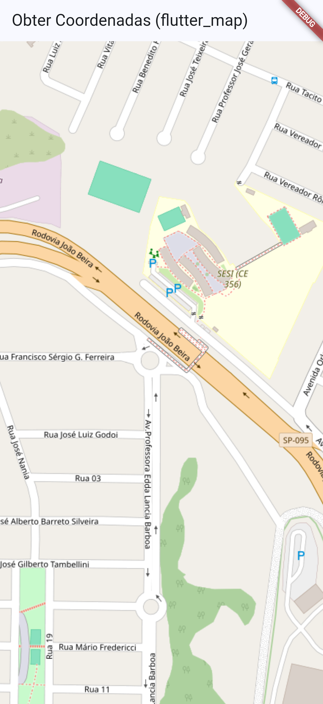

# Flutter Maps

Projeto desenvolvido com base no tutorial de Flutter Maps.

## Sobre o projeto

O Flutter Maps é um aplicativo que apresenta um mapa interativo utilizando o OpenStreetMap. Ao clicar em um ponto do mapa, o aplicativo exibe a latitude e a longitude da localização selecionada e adiciona um marcador vermelho no local.

## Tecnologias utilizadas

- Flutter
- Dart
- flutter_map
- latlong2
- OpenStreetMap

## Funcionalidades

- Visualização de mapa interativo.
- Seleção de pontos no mapa.
- Identificação da latitude e longitude.
- Exibição de marcador no local selecionado.

## Captura de tela

Abaixo está a captura de tela do aplicativo em funcionamento.



##  Como executar o projeto

Clone este repositório:

```bash
git clone https://github.com/Juhgabrielly/flutter_maps_nativo.git
```

Entre na pasta do projeto:

```bash
cd flutter_maps_nativo
```

Instale as dependências:

```bash
flutter pub get
```

Execute o aplicativo no Google Chrome:

```bash
flutter run
```

**Requisito:** ter o Flutter instalado e uma conexão com a internet para carregar o mapa.

## APK para Android

O arquivo APK para instalação em dispositivos Android está disponível na pasta `assets/`.

**Arquivo:** `assets/app-release.apk`